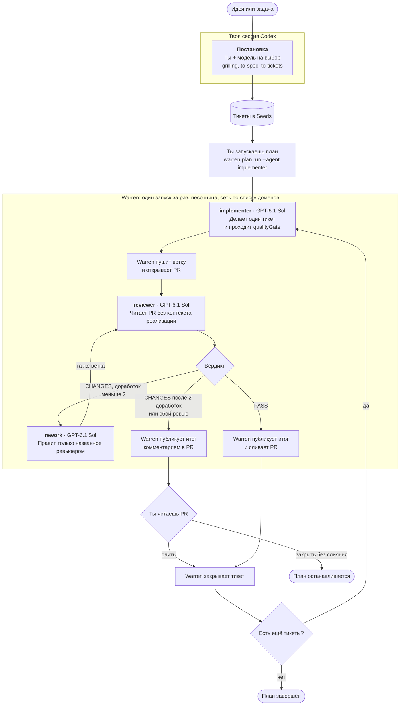

# Software Factory

Личная фабрика кода: тикеты превращаются в проверенные PR, а последнее слово всегда за человеком. Агенты работают на Mac владельца, через Codex CLI на подписке ChatGPT, каждый запуск изолирован в песочнице.

Это форк [Warren](https://github.com/jayminwest/warren) 0.19.3 (MIT), автор которого прекратил поддержку. Это не проект Warren и не сервис warren.run. Навыки агентов взяты из [pstack](https://github.com/cursor/plugins/tree/main/pstack) и [skills Мэтта Пококка](https://github.com/mattpocock/skills). Решения и история сборки записаны в [docs/PLAN.md](docs/PLAN.md).

## Как идёт работа



Следующий тикет стартует только после слияния предыдущего PR. После вердикта `PASS` Warren сливает PR сам (`WARREN_PLAN_RUN_MERGE_ON_PASS=1`). Если замечания остались или ревью сорвалось, PR ждёт тебя.

## Агенты цепочки

| Агент | Где работает | Модель | Цель | Суть работы | Навыки |
|---|---|---|---|---|---|
| Постановка | Твоя сессия | На твой выбор | Превратить идею в понятные тикеты | Допрашивает тебя, фиксирует термины, пишет спецификацию и режет её на тикеты | `grilling`, `domain-modeling`, `to-spec`, `to-tickets`, `wayfinder`, `prototype` |
| `implementer` | Песочница Warren | GPT-6.1 Sol | Сделать один тикет | Следует подходящему сценарию pstack, пишет код и тесты, проходит `qualityGate`, коммитит | `poteto-mode`, `architect`, `typescript-best-practices`, `tdd`, `diagnosing-bugs`, `codebase-design`, `go-best-practices` |
| `reviewer` | Песочница Warren | GPT-6.1 Sol | Независимо проверить PR | Сверяет diff с тикетом и стандартами, пытается сломать код, ищет дефекты безопасности, ничего не меняет | `code-review`, `interrogate`, `blast-radius` |
| `rework` | Песочница Warren | GPT-6.1 Sol | Закрыть замечания ревью | Подтверждает каждое замечание и вносит минимальную правку в ту же ветку. Запускается не больше 2 раз на PR | `diagnosing-bugs`, `go-best-practices` |

Остальные роли Warren (`claude-code`, `pi`, `planner`, `pr-fixer`, `healer`, `nightwatch`, `bugwatch`) есть в реестре, но в цепочке не участвуют. Большинство из них работает на Pi и подпиской ChatGPT не пользуется.

## Запуск

Нужны macOS, [Codex CLI](https://developers.openai.com/codex/cli) с входом через ChatGPT, `gh`, Go 1.25, `golangci-lint` и:

```bash
npm i -g bun@1.3.14 @os-eco/seeds-cli@0.5.13 @os-eco/mulch-cli@0.10.7
```

Сначала войди в Codex с файловым хранением авторизации:

```bash
codex login -c 'cli_auth_credentials_store="file"'
codex login status
```

Warren использует только вход ChatGPT. Подробности авторизации, моделей и ограничений: [инструкции Codex](docs/codex-runtime.md).

Установка фабрики:

```bash
bun install --frozen-lockfile && bun run build:ui
```

Запуск сервера с интерфейсом на `localhost:8080`. При первом старте мастер использует существующий вход Codex и запросит GitHub-токен. Выдавай токен только на нужные репозитории и не соглашайся использовать токен `gh`:

```bash
bun src/cli/main.ts up
```

При Ctrl-C Warren останавливает локальные jobs и сохраняет credentials. После рестарта прерванная работа сохраняется в Git bundle. Модельная сессия не продолжается. См. [остановку и восстановление](docs/codex-runtime.md#остановка-и-восстановление).

## Работа с проектом

1. В сессии Codex подключи проект через `scripts/connect-project.ts` (его параметры доступны с `--help`).
2. Добавь репозиторий в GitHub-токен Warren.
3. В сессии проекта подготовь спецификацию и тикеты Seeds. Навыки `to-spec` и `to-tickets` можно прочитать из `factory/skill-pack`.
4. Запусти тикеты по порядку:

```bash
bun src/cli/main.ts plan run --project <prj_id> --agent implementer --issues <id1,id2> --max-cost-usd 5
```

5. Разбирай PR, которые ревью не пропустило. Остальные сольются сами.

## Новые проекты

Шаблон лежит в [`factory/template`](factory/template): Go 1.25, React, TypeScript, Vite, Tailwind и компоненты в стиле shadcn/ui. Проверка качества одна: `scripts/check.sh`.

## Что где лежит

| Путь | Что там |
|---|---|
| [`factory/skill-pack`](factory/skill-pack) | Закреплённые копии навыков, версии в `LOCK.json` |
| [`factory/template`](factory/template) | Шаблон новых проектов |
| [`scripts/connect-project.ts`](scripts/connect-project.ts) | Механика подключения проектов |
| [`src/registry/builtins/factory-roles.ts`](src/registry/builtins/factory-roles.ts) | Промпты и модели агентов |
| [`src/plan-runs/review.ts`](src/plan-runs/review.ts) | Шаг ревью и доработки |

## Status

Stable (`0.19.3`): версия Warren, на которой основан форк. Ограничения:

- Лимиты подписки общие с другими сессиями Codex. `maxCostUsd` показывает оценку эквивалентного API-расхода в конце запуска. Время работы ограничено 20 минутами по умолчанию.
- Запуск через Docker после удаления Kubernetes не проверялся, навыки туда не доставляются.
- Рабочий режим проверен только на macOS.

## Лицензия

MIT, см. [LICENSE](LICENSE).
